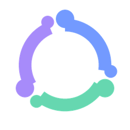
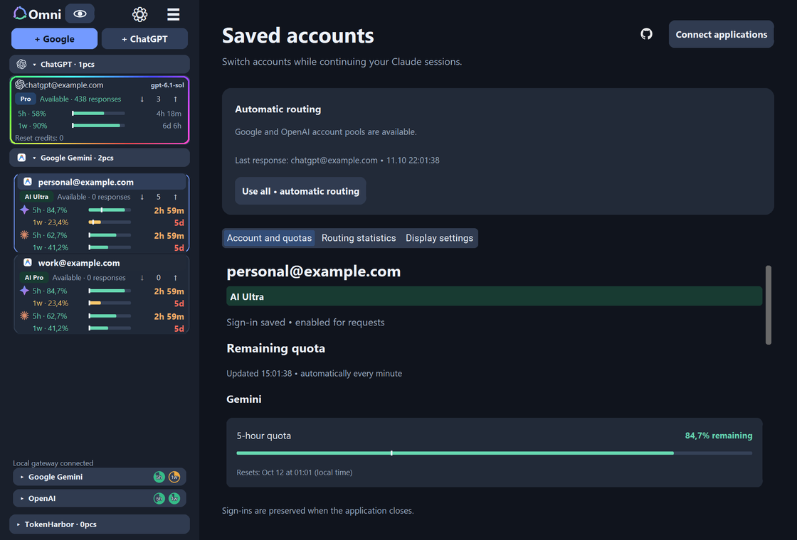
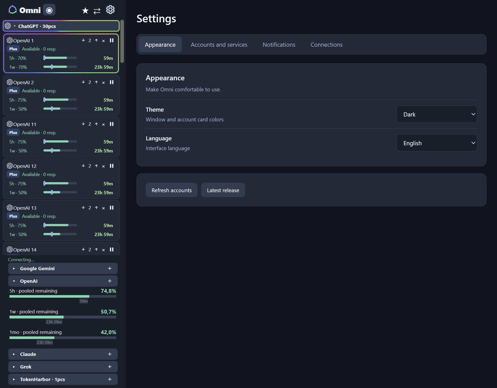
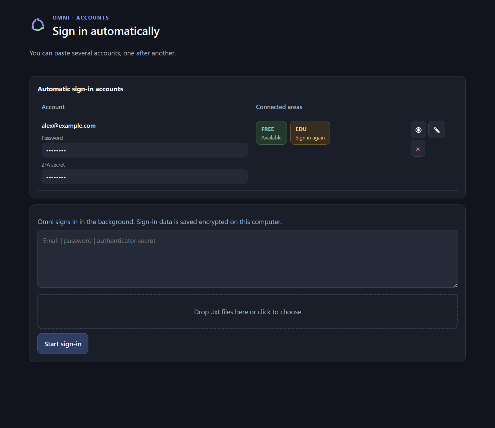

<p align="center"></p>
<h1 align="center">Omni</h1>
<p align="center">AI accounts, quotas, models and app connections in one place.</p>
<p align="center">
  <a href="https://github.com/nikitaeight24family/Omni/releases/tag/v1.6.1"></a>
  <a href="https://github.com/nikitaeight24family/Omni/actions/workflows/build.yml"></a>
  <a href="LICENSE"></a>
</p>
<p align="center">
  <a href="https://github.com/nikitaeight24family/Omni/releases/download/v1.6.1/Omni-Setup.exe"><b>Download Omni 1.6.1 for Windows</b></a> ·
  <a href="https://github.com/nikitaeight24family/Omni/releases/tag/v1.6.1">Release files</a> ·
  <a href="CLI.md">CLI guide</a>
</p>

Omni connects Google Antigravity/Gemini, ChatGPT, Claude, Grok and TokenHarbor accounts, displays quotas and routes requests through a local gateway. Codex, Claude Code, Claude Desktop and the CLI receive the current model catalog from the connected accounts.

Version **1.6.1** is the Electron desktop build for Windows. The Python application and CLI remain in the repository for macOS, Linux, Windows CLI use and compatibility with older installations.

## Omni windows

The main window shows accounts, quotas, models, activity and automatic routing:

<p align="center"></p>

Display, language, service, notification and connection settings:

<p align="center"></p>

The separate automatic sign-in window shows one row per account and connected areas as status badges. Saved sign-in data can be revealed, edited with the pencil button or removed with the cross button. Multiple records and batches of TXT files are supported.

<p align="center"></p>

Screenshots use demonstration data. Real passwords, 2FA secrets, tokens and request history are never included in the repository.

## What's new in 1.6.1

- Separate Electron automatic sign-in window for ChatGPT.
- The automatic sign-in table includes only identities with saved automatic sign-in data.
- One row per account with separate Free, EDU and K12 area badges.
- Encrypted sign-in data can be viewed, edited or deleted from the manager.
- Bulk paste and drag-and-drop for multiple `.txt` files.
- Problem accounts are excluded from the global account count.
- Selected workspaces are remembered and quota availability is verified after sign-in.
- The active model is shown on collapsed account cards.
- Smooth Electron scrolling without rebuilding every card during scroll.
- Automatic model-catalog synchronization for Codex, Claude and the CLI.
- Refreshed settings and application-connection screens.

## Windows installation

1. Download [Omni-Setup.exe](https://github.com/nikitaeight24family/Omni/releases/download/v1.6.1/Omni-Setup.exe) from **v1.6.1**.
2. Run the installer. Python and administrator access are not required.
3. Open Omni and add accounts with the `+` button in the relevant provider section.

Updates preserve accounts and settings. The portable `Omni.exe` build is also included in the release files.

## Accounts and automatic sign-in

Omni supports:

- Google Antigravity/Gemini;
- ChatGPT/Codex with Free, EDU/K12 and other available workspaces;
- native Claude and Grok accounts;
- TokenHarbor and API keys.

ChatGPT supports normal sign-in, an isolated browser sign-in and **Sign in automatically**. Automatic sign-in accepts common separators, multiple records and `.txt` files. Credentials are encrypted with Windows `safeStorage`.

After sign-in, Omni checks every workspace, selects the requested workspace, remembers its identifier and verifies real quota availability. A callback alone is never treated as a successful sign-in.

## Quotas and routing

- 5h is displayed above 1w;
- quotas and reset times refresh in the background;
- unavailable and problem accounts are excluded from the global count;
- parallel requests are distributed across accounts in the same provider pool;
- a saturated route is retried through another available account or model;
- manual priorities and quota reserves are preserved;
- active accounts show their current model and animated color highlight.

## Application connections

In **Connect applications**, Omni checks and updates client configuration:

| Application | Updated configuration |
| --- | --- |
| Codex Desktop / CLI | local gateway, Responses API and model catalog |
| Claude Code CLI | gateway URL, key, models and CLI settings |
| Claude Desktop | Code provider and available models |

The model catalog is regularly synchronized with the connected accounts. Old models are removed and newly available models are added automatically. Original configuration files are backed up before changes.

## CLI and other operating systems

The CLI is available for Windows, macOS and Linux. Download the matching archive from the [v1.6.1 release](https://github.com/nikitaeight24family/Omni/releases/tag/v1.6.1). From source:

```sh
python console.py
python console.py status
python console.py models
python console.py configure --clients claude_cli codex
python console.py serve
```

See [CLI.md](CLI.md) for the complete terminal guide.

## Storage and security

The gateway and native service listen on localhost only (`127.0.0.1`). Public builds contain no accounts, passwords, tokens, keys or request history. Windows uses DPAPI/safeStorage; macOS and Linux use local encryption and user-only file permissions.

Never publish `auth`, `config.yaml`, `preferences.json`, `client-key.txt` or diagnostic archives containing personal data.

## Development

```sh
python -m pip install -r requirements.txt
python -m unittest discover -s tests
cd electron
npm install
npm test
npm run pack -- --config.directories.output=dist-local
```

Electron sources are in `electron/`, the Python backend is in the repository root and the CLI entry point is `console.py`. Run the complete local test suite and build every affected platform before publishing a release.

## History

The project was previously called **Gemini Accounts**. Legacy executable names and data directories remain compatible with existing installations.
