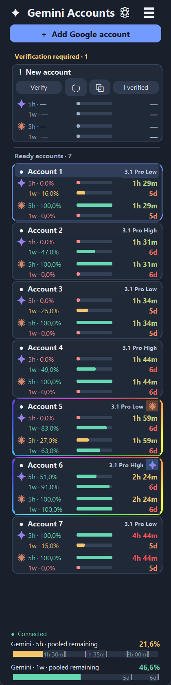

# Gemini Accounts

Google Antigravity account manager with Gemini / Claude quota monitoring and a local gateway for Claude Code and Codex. English interface and documentation. Available as a **Windows desktop app** and a **terminal app for Windows, macOS and Linux**.

## Windows desktop: three steps



Screenshot uses demo accounts and example quota values.

1. [Download GeminiAccounts-Setup.exe](https://github.com/nikitaeight24family/GeminiAccounts/releases/latest/download/GeminiAccounts-Setup.exe) and click **Install**. No Python or administrator access required.
2. Click **+ Google** to sign in through a browser, or **+ ChatGPT** to sign in with a ChatGPT account. ChatGPT sign-in opens an isolated Edge/Chrome profile for each account, so multiple accounts can be added without switching the browser's everyday account. Enter the password and 2FA code on the official sign-in page. Existing Codex `auth.json` files can still be imported from the same menu.
3. Open **Connect applications** and approve setup of installed clients. Original configs are backed up. Restarting running clients requires separate consent.

A desktop shortcut is created. Updates preserve accounts and configurations; active requests block an update. Install Claude / Codex clients separately.

## Terminal: Windows, macOS and Linux

Download the matching CLI archive from [Releases](https://github.com/nikitaeight24family/GeminiAccounts/releases/latest), extract it and open a terminal in that folder. Python is included. The first run downloads a checksum-verified native service.

| Platform | Archive | Start |
| --- | --- | --- |
| Windows x64 | `GeminiAccounts-CLI-windows-x64.zip` | `.\GeminiAccounts-CLI.exe` |
| Mac with Apple Silicon | `GeminiAccounts-CLI-macos-arm64.tar.gz` | `./gemini-accounts` |
| Mac with Intel | `GeminiAccounts-CLI-macos-x64.tar.gz` | `./gemini-accounts` |
| Linux x64 | `GeminiAccounts-CLI-linux-x64.tar.gz` | `./gemini-accounts` |

Use the interactive menu for sign-in, quotas, verification, client setup and restoration. Keep it open while using clients. **Ctrl+C / Exit** stops services started by that terminal and preserves accounts. Services already running from another instance are reused and are not stopped on exit.

Mac executables are not notarized. macOS may require approval in **System Settings → Privacy & Security**. Source launch is also available. See the [terminal guide](CLI.md).

## Connections and restoration

| Client | Changes after approval |
| --- | --- |
| Claude Desktop on Windows | Local gateway preset for the **Code** tab. Choose available Gemini and Claude models in Claude's model menu. Ordinary web chats retain their own connection. |
| Claude Code CLI, all supported platforms | Gateway URL, local key, model defaults and gateway model discovery merged into `~/.claude/settings.json`. Choose an available model with `/model`. |
| Codex Desktop on Windows / Codex CLI | Responses API provider and a local model catalog in `~/.codex/config.toml`. Choose an available model in Codex. The existing Codex models stay in the catalog. |

Before any changes, the app lists affected files and asks for consent. Projects, sign-ins and session history are preserved. History is not transferred between applications. Organizational policies may prevent third-party providers. Automatic Claude Desktop setup and desktop client restarting are Windows-only; Mac terminal mode configures Claude Code CLI and Codex CLI.

**Restore:** desktop **☰ → Connect applications → Restore previous settings / reset preferences**, or terminal `./gemini-accounts restore`. After confirmation, exact original configs are restored and files that did not exist before setup are removed. Later edits to those files are replaced by their original backups. App preferences return to defaults. **Google sign-ins are kept.** Restart clients afterward.

## Features

- Choose models directly in Claude or Codex after connecting that application from **Connect applications**. The connection offers distinct available Gemini Pro, Flash and Claude model IDs; selecting one sends requests to that exact model. To refresh a client's model menu after account changes, open **Connect applications** again and approve reconnecting it. Client configurations change only after this explicit action.
- ChatGPT accounts added through **+ ChatGPT** appear in their own expandable list. Each browser login uses a fresh private profile and the gateway stores accounts separately for routing. The app never receives passwords or 2FA codes. It reads available GPT models from the local gateway and shows account quota windows, reset countdowns and reset credits when the provider supplies them. Adding an account alone does not reconfigure Claude or Codex; use **Connect applications** afterward to add the available GPT models to an approved client's menu. ChatGPT account tokens stay in the local gateway's private auth directory and are excluded from diagnostic exports.
- Optional TokenHarbor **Claude Haiku 5.5 Free**: click **TokenHarbor · Haiku 5.5 Free** directly below **Add Google account**, paste a TokenHarbor Universal Key, and approve the shown file changes. The app tests the exact `claude-haiku-5.5:free` route through TokenHarbor and the local gateway before adding it to an already approved Claude Desktop Code menu; connected Claude Code CLI installations can select its unique model ID with `/model`. No paid fallback is configured. This is a limited-time offer; its allowance and expiry are shown in the TokenHarbor dashboard. TokenHarbor requires free-model access on your account and says free-route prompts and responses may be retained. The key is stored in the local gateway configuration; **Remove TokenHarbor connection** deletes the provider and menu entry.
- The TokenHarbor key list identifies the key used by each completed request from the gateway's credential ID. It keeps the last-used key marked without flashing all cards during generation, and shows each key's latest success or error (including 429). The current key is known only after the gateway publishes usage. The connection window shows published free-account API rate limits; use **Balance and reset** to see the live campaign allowance in TokenHarbor. TokenHarbor does not document a read API for the remaining campaign quota or reset time, so the application does not invent either value.
- Four account quota bars: Gemini / Claude, **5h / 1w**, with reset countdowns and time-based colors.
- Account cards and quota controls persist during refreshes. Percentages, bars, status and countdowns update in place; crossing the weekly 1% threshold hides or restores existing rows without rebuilding the cards.
- ChatGPT accounts with an applicable usage reset show **Use usage reset** and the earliest expiry. Applying a reset requires confirmation, rechecks availability, and clears only that account's gateway cooldown after provider confirmation. The provider chooses which credit is consumed; the app does not automatically repeat a reset request after a timeout.
- Compact cards, sorted by Gemini's five-hour reset, with verification accounts pinned separately.
- Selecting an account for details works only while the right panel is open. Compact mode removes selection and hover highlights; verification buttons remain usable.
- Pooled Gemini 5h / 1w bars with vertical markers for projected quota after exhausted windows reset.
- Last requested model appears in card headers for one minute. Independent Gemini and Claude badges and animated borders appear only while that provider has a running gateway request; idle and quota-wait states clear them.
- Prioritizes available accounts by the nearest **5h** reset for the ranked model family. Weekly quota determines whether the account can be used; its countdown does not change the five-hour order. Native failover switches exhausted accounts. Gemini and Claude can use different accounts simultaneously.
- Request, failure and switch statistics with reasons.
- Streaming keep-alives while waiting for genuine quota blocks; the real response follows when quota is available. Client cancellation cancels the wait. Pending requests are not saved to disk.
- Waits three minutes after detecting a full 5h quota before a minimal `Hi` request with one output token through Gemini Flash / GPT-OSS, unless client work already starts the window. Exhausted weekly quotas are skipped.
- Quotas update every minute. Desktop countdowns update every 15 seconds. Terminal monitoring runs while the menu / `serve` is open.

## Availability and storage

Google Antigravity determines account eligibility, models and quotas. A Gemini web subscription alone does not guarantee access to Claude or every model. This is an independent project, not an official Google, Anthropic or OpenAI application.

Gateway: `127.0.0.1:8317`; native service: `127.0.0.1:8318`. Both are local-only. Each installation receives random keys. Releases contain no personal sign-ins, private keys or history.

Windows uses LocalAppData, or an existing Codex LocalCache installation. macOS uses `~/Library/Application Support/GeminiAccounts`; Linux uses `$XDG_DATA_HOME/GeminiAccounts` or `~/.local/share/GeminiAccounts`. `GEMINI_ACCOUNTS_HOME` selects an explicit runtime root. Google sign-ins are in `ClaudeGemini/auth/`.

Windows protects management keys, verification state and backups with **DPAPI**. Mac / Linux encrypt these files with **Fernet** and a user-only local storage key; this is file-permission protection, not Keychain integration. Keep the storage key with the protected data. Never publish installed auth folders, keys or client configs.

## Development

Python 3.12+. Desktop: `requirements.txt`; terminal-only: `requirements-cli.txt` (no Tk or GUI dependencies).

```sh
python -m pip install -r requirements-cli.txt
python console.py --help
python -m unittest tests.test_console tests.test_accounts tests.test_activity tests.test_quota_queue tests.test_quota_starts tests.test_routing
```

Windows build: `build-release.ps1`. Terminal binary: `python -m PyInstaller --onefile --name gemini-accounts --add-data assets/cliproxy-models.json:assets --collect-all tzdata console.py` on macOS / Linux (use `;assets` on Windows). GitHub Actions builds and tests Windows, Mac Apple Silicon / Intel and Linux editions. Native CLIProxyAPI is pinned to **8.0.16**, with committed SHA-256 checksums and its license included. Client configuration interfaces may change with client updates.

Documentation: [Codex configuration](https://learn.chatgpt.com/docs/config-file/config-advanced), [Claude Code environment variables](https://code.claude.com/docs/en/env-vars), [CLIProxyAPI](https://github.com/router-for-me/CLIProxyAPI).

### Diagnostic logs

Request lifecycle logging is automatic, including active requests, quota waits, upstream attempts, streaming progress, cancellations and failures. **Routing statistics → Save diagnostic log…** exports a ZIP with rotated JSONL logs, request history and a live state snapshot. No prompts, generated text, authentication tokens or client configuration files are included. Logs contain account names. Terminal: `./gemini-accounts diagnostics --output diagnostics.zip` (Windows: `GeminiAccounts-CLI.exe diagnostics --output diagnostics.zip`). The export also works when services are offline.

Windows desktop checks GitHub for newer releases. **Routing statistics → Update to …** downloads the verified installer, waits for active requests, replaces application files and restarts services. Client configurations are not automatically rewritten. **Send diagnostic log…** requires owner confirmation for every upload, uses the configured HTTPS recipient and replaces email addresses with account labels. The default recipient is https://logs.conch-labs.com/ingest. An upload access token is required and stored encrypted locally; no token is embedded in public builds.
